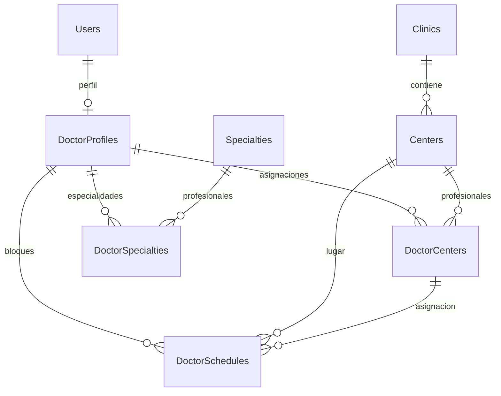

# Esquema de administración de clínica v0.3.0

PostgreSQL 18 y EF Core 10. Las claves nuevas siguen el criterio UUID de identidad.
Se añade una migración independiente, AddClinicDoctorsCentersSpecialtiesSchedules;
20260930042300_InitialIdentity permanece intacta.



| Tabla | PK | FK | UNIQUE |
| --- | --- | --- | --- |
| Clinics | Id uuid | — | PK y CHECK de Id fijo limitan la clínica a una fila |
| Centers | Id uuid | ClinicId → Clinics | Code; ClinicId cuando IsMain AND IsActive |
| DoctorProfiles | Id uuid | UserId → Users | UserId; ProfessionalLicense cuando no es NULL |
| Specialties | Id uuid | — | Code; Name |
| DoctorSpecialties | DoctorId + SpecialtyId | DoctorId → DoctorProfiles; SpecialtyId → Specialties | PK compuesta |
| DoctorCenters | DoctorId + CenterId | DoctorId → DoctorProfiles; CenterId → Centers | PK compuesta |
| DoctorSchedules | Id uuid | DoctorId → DoctorProfiles; CenterId → Centers; (DoctorId, CenterId) → DoctorCenters | — |

Las FK usan RESTRICT para impedir pérdidas por cascada. El índice parcial de sucursal principal
garantiza como máximo una principal activa, incluso ante solicitudes concurrentes.
El UUID fijo de Clinics es 00000000-0000-0000-0000-000000000001; no representa un tenant.

## Tipos y restricciones

Campos obligatorios tienen NOT NULL y límites de longitud. Los CHECK validan textos requeridos,
códigos normalizados, coordenadas (latitud -90..90; longitud -180..180), matrícula normalizada,
día ISO y consistencia de horas/descanso. Campos opcionales se normalizan a NULL cuando están vacíos.
ProfessionalLicense es opcional; cuando tiene valor se normaliza y su índice único evita duplicados.
BirthDate es date. Las horas son time without time zone. CreatedAt, UpdatedAt y AssignedAt son
timestamp with time zone y la aplicación utiliza UTC.

Los índices de FK permiten recorrer relaciones y las búsquedas de horarios se apoyan en doctor/día/estado.
La consulta de horarios comprende todas las sucursales del doctor; nunca se filtra por sucursal antes
de comprobar conflictos. Los extremos adyacentes son válidos y el descanso forma parte del intervalo ocupado.

## Estado y conservación

Clinic, Center, DoctorProfile y Specialty se conservan al desactivarlos. No existen endpoints DELETE.
DoctorCenter conserva la relación y su estado; retirar una asignación no borra sus horarios históricos.
DoctorSpecialty es una asignación actual reemplazable transaccionalmente, con AssignedAt por vínculo.
No se persisten arrays ni JSON para representar relaciones. MetadataJson de AuditLogs sigue siendo
exclusivamente información auxiliar, sin credenciales ni fichas profesionales completas.

## Seed y verificación

El seed explícito crea una sola clínica y los doce códigos iniciales de especialidades; se puede repetir
sin duplicar ni sobrescribir las personalizaciones existentes. No siembra doctores ni sucursales.

```powershell
dotnet build
powershell -NoProfile -ExecutionPolicy Bypass -File scripts/initialize-clinic.ps1
Get-Content database/scripts/verify-clinic.sql | docker compose exec -T postgres psql -U clinica_user -d clinica_ramirez -X -v ON_ERROR_STOP=1
```

La base de desarrollo se conserva en el volumen existente, publicada en localhost:5434.
La API usa postgres:5432 internamente. Las pruebas backend usan bases aisladas identity_test_<uuid>.
