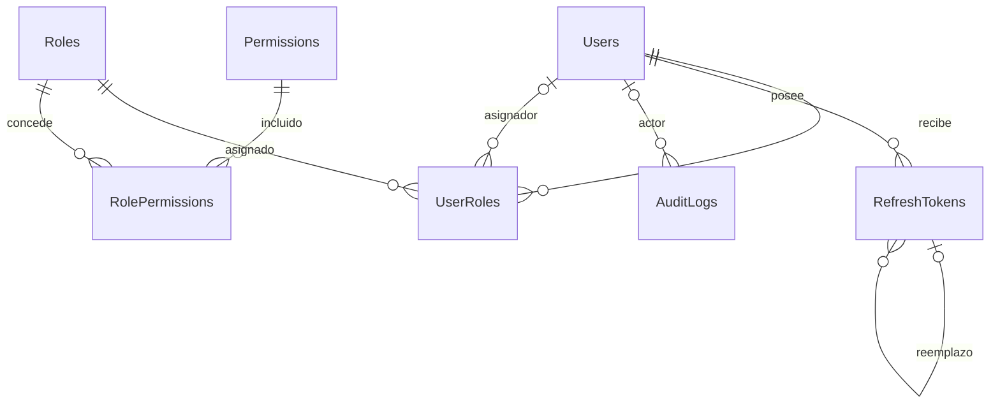

# Esquema relacional de identidad v0.2.0

Migración conservada: 20260930042300_InitialIdentity. Siete tablas de aplicación, más __EFMigrationsHistory. No se usa EnsureCreated, EnsureDeleted ni migración automática al iniciar.

| Tabla | PK | FK | UNIQUE adicional |
| --- | --- | --- | --- |
| Users | Id uuid | — | Email |
| Roles | Id uuid | — | Code, Name |
| Permissions | Id uuid | — | Code |
| UserRoles | UserId + RoleId | UserId → Users; RoleId → Roles; AssignedByUserId nullable → Users | PK compuesta |
| RolePermissions | RoleId + PermissionId | RoleId → Roles; PermissionId → Permissions | PK compuesta |
| RefreshTokens | Id uuid | UserId → Users; ReplacedByTokenId nullable → RefreshTokens | TokenHash |
| AuditLogs | Id uuid | UserId nullable → Users | — |

Todas las FK usan RESTRICT. No hay cascadas destructivas. Índices adicionales: FK no cubiertas por PK, Permissions.Module, RefreshTokens.ExpiresAt, AuditLogs.CreatedAt, AuditLogs.Action y AuditLogs(Entity, EntityId). Los UNIQUE se implementan mediante índices únicos.

Campos obligatorios usan NOT NULL; datos opcionales (Phone, Description, LastLoginAt, revocación, IP, actor y MetadataJson) permiten NULL según entidad. Timestamps usan timestamp with time zone y valores UTC desde aplicación. Email se normaliza con trim/lowercase, tiene índice único y CHECK. CHECK adicionales validan nombres de usuario no vacíos, PasswordHash no vacío, formato de Roles.Code, longitud del hash de refresh y vencimiento posterior a creación.

User conserva identidad, PasswordHash, estado, verificación de email y timestamps. Role conserva Code estable, nombre, descripción, IsSystem e IsActive. Permission conserva Code, nombre, módulo y fecha. Las relaciones N:M están exclusivamente en tablas puente; no se representan con JSON ni listas de texto. MetadataJson jsonb contiene únicamente información auxiliar de auditoría.

## Desarrollo y pruebas

PostgreSQL interno postgres:5432; acceso local localhost:5434. El volumen de desarrollo se conserva. scripts/initialize-identity.ps1 carga .env sin imprimirlo, aplica la migración explícitamente y ejecuta seed. Repetirlo no duplica catálogo ni bootstrap.

scripts/test-backend.ps1 ejecuta xUnit contra una base identity_test_<uuid> nueva dentro del mismo PostgreSQL. Usa migraciones reales y no toca clinica_ramirez. Las bases de pruebas se conservan para inspección; no se eliminan automáticamente. Contienen exclusivamente datos sintéticos y contraseñas aleatorias de prueba.
